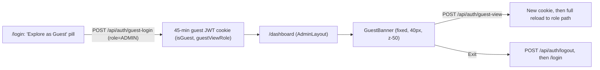

# BITS Guest Experience — Audit, Research & Implementation Plan

> [!NOTE]
> **No code has been changed.** This is a plan for your review.
> Each finding is tagged with its source:
> **[Code]** = seen in our repo · **[Research]** = published guidance · **[Judgment]** = my own reasoning for this project

> [!CAUTION]
> **Possible P0 regression on `feature/guest-mode`, and it affects every user, not just guests.**
> Commit `9ee99a2` changed the sidebar `<aside>` from `z-60` to `z-40` for everyone ([BaseSidebar.tsx:92](file:///c:/antigravity-proj/samananias-org/bits/frontend/src/components/layout/shared/BaseSidebar.tsx#L92)).
> But the mobile backdrop on the line above is `z-50` ([BaseSidebar.tsx:85](file:///c:/antigravity-proj/samananias-org/bits/frontend/src/components/layout/shared/BaseSidebar.tsx#L85)).
> Below the `lg` breakpoint, the backdrop now sits **on top of** the open sidebar. A tap on a menu link would hit the backdrop and close the drawer instead.
> I traced this through the stacking order but haven't tested it in a browser yet. It's fixed in Step 1 regardless.

---

## A. Current-State Audit

### A1. How the guest flow works today [Code]



- **Server-side protection works and should stay as is.** `guestGuard` returns 403 on any write request. PII is masked recursively ([guestGuard.middleware.ts](file:///c:/antigravity-proj/samananias-org/bits/backend/src/shared/middleware/guestGuard.middleware.ts)).
- **Switching roles is already supported.** The JWT's `guestViewRole` is the guest's identity. [useAuth.ts:55-61](file:///c:/antigravity-proj/samananias-org/bits/frontend/src/hooks/useAuth.ts#L55-L61) checks layout access against it. So *switching dashboard* and *guest identity* are one concept in our architecture.
- **Bits has no self-registration UI.** Accounts are created by admins. A "Create account" call to action doesn't apply. The only conversion path is **Sign in**.
- **Sign-in doesn't keep context.** [useLogin.ts:77-94](file:///c:/antigravity-proj/samananias-org/bits/frontend/src/features/auth/hooks/useLogin.ts#L77-L94) redirects by role and ignores the `?from=` param that [proxy.ts:43](file:///c:/antigravity-proj/samananias-org/bits/frontend/src/proxy.ts#L43) sets. That's correct here: a guest viewing the Admin dashboard may sign in as an `USER`. Sending them back to the guest's path would make `useAuth` bounce them to `/login`.

### A2. Problems found

| # | Issue | Evidence | Severity |
|---|---|---|---|
| 1 | Sidebar hidden under its own backdrop on mobile (all users) | `z-40` aside vs `z-50` backdrop | **P0** |
| 2 | **Guest status shown three times** on one screen | Crimson banner + topbar `Guest: Admin` pill + profile menu's "Guest Session" and amber "Read-Only Access" pill | High |
| 3 | Banner takes **40px of height on every page** (~6% of a 712px viewport) | [GuestBanner.tsx:93](file:///c:/antigravity-proj/samananias-org/bits/frontend/src/components/layout/shared/GuestBanner.tsx#L93) | High |
| 4 | **Hard-coded offsets in 9 places** (`top-[40px]`, `lg:top-[120px]`, `mt-[104px]`, `6.5rem`) | 4 layouts, 2 topbars, `BaseSidebar` | High (fragile) |
| 5 | Banner probably overflows on phones: role tabs, Exit and status pill (~420px) wrap inside a fixed `h-[40px]` | `flex-wrap` + fixed height | Medium (check at 375px) |
| 6 | Dark crimson bar sits above a light topbar, so it looks like a separate product | Banner vs `bg-gray-50` / `bg-white` topbars | Medium |
| 7 | Guests see **"Account Settings"**, which leads to forms that always return 403 | [admin-topbar.tsx:202](file:///c:/antigravity-proj/samananias-org/bits/frontend/src/components/layout/admin-topbar.tsx#L202), [hr-topbar.tsx:141](file:///c:/antigravity-proj/samananias-org/bits/frontend/src/components/layout/hr-topbar.tsx#L141) | Medium |
| 8 | Topbar guest pill text is hard-coded per file (`"Guest: Admin"`) and isn't clickable | 4 topbars | Low |
| 9 | Blocked-action toast: its timer cleanup is returned from the event handler, so it never runs. Repeated blocks can close a newer notice early. It also has no `aria-live`. | [GuestBanner.tsx:36-43](file:///c:/antigravity-proj/samananias-org/bits/frontend/src/components/layout/shared/GuestBanner.tsx#L36-L43) | Low |
| 10 | **Login:** guest-login errors appear under the **password** field | [useLogin.ts handleGuestLogin](file:///c:/antigravity-proj/samananias-org/bits/frontend/src/features/auth/hooks/useLogin.ts#L104-L134) uses `setValidationErrors({ password })` | Medium |
| 11 | **Login:** the pill has no visible keyboard focus style | [LoginForm.tsx:37](file:///c:/antigravity-proj/samananias-org/bits/frontend/src/features/auth/components/LoginForm.tsx#L37) | Medium (a11y) |

**Keep:** backend guard and masking, the `guest-login` / `guest-view` routes, role-switch-by-reload, the login pill's position, and the `isGuest` flag passed down from layouts.

---

## B. UX/UI Research and How It Applies to Bits

| Principle / Source | What it says | What it means for Bits |
|---|---|---|
| **NN/g heuristic #1: Visibility of system status** | Users should always know the system's current state | Guest status must stay **visible on every page**. Hiding it only in a menu would break this. |
| **NN/g heuristic #4: Consistency and standards**, plus NN/g **utility navigation** research | Users look for sign-in, sign-out and account state in the **top-right** of the header. Moving them elsewhere makes them harder to find. | Our topbar already has an account slot in the top-right, next to the avatar. That's where guest identity, role switching and sign-in belong. |
| **NN/g heuristic #8: Aesthetic and minimalist design** | Every extra element competes with the ones that matter | Showing guest status three times is noise. One clear indicator is enough. |
| **Material Design 3: FAB guidance** | A FAB is for the **single most important action on a screen** (create, compose). Not for navigation, sign-out or rare actions. | Role switching is navigation and Exit is a session action. A floating button would **misuse the pattern**. Bits also has no FABs today. |
| **WCAG 2.2 SC 2.4.11 Focus Not Obscured (AA)** | Floating or sticky content must not completely hide a keyboard-focused element | A bottom-corner floating control would cover table pagination, row actions and modal footers on our data-heavy pages. |
| **WAI-ARIA APG: Menu Button vs Disclosure** | Use `role="menu"` for app-style **commands** (switch account, sign out). Use a disclosure for **links**. | Our popover holds commands (switch view, sign in, exit). The APG **menu button** pattern fits: Arrow keys, Esc, focus returns to the trigger. |
| **Material 3 / Apple HIG: button emphasis** | One high-emphasis button per area. Alternatives use lower emphasis. | `LOG IN` stays the only solid red button. The guest pill stays tonal or outlined, as it is now. |

**How comparable products do it [Research + Judgment]:**
- **Stripe** shows a "Test mode" badge in its header, attached to the account and environment switcher. That's a state with no real consequences, shown inline.
- **Salesforce and Shopify staff impersonation** use full-width banners, because staff actions there affect **real data**.
- Bits guests **can't write anything** (enforced on the server). The stakes are closer to Stripe's test mode than to impersonation. That supports a **lighter indicator inside the header** rather than a banner.
- **Google's account menu** puts identity, account switching and sign-out in one popover. That matches our finding that view-role and guest identity are the same concept.

---

## C. Proposed Design

### C1. Login entry: keep the pill, make targeted fixes

The header-row pill is already the right pattern [Judgment, based on the research above]:
- It's easy to find without competing with `LOG IN`.
- It doesn't change the card's height.
- It matches the rounded-full shape of our existing buttons.

**Don't redesign it.** Fix only:

1. **Focus ring:** add `focus-visible:outline-none focus-visible:ring-2 focus-visible:ring-red-500 focus-visible:ring-offset-2` (fixes #11).
2. **Error location:** add a separate `guestError` state, shown as a small `text-xs text-red-600` line below the header row with `role="alert"`, instead of reusing the password error (fixes #10).
3. **Accessible description:** add `aria-describedby` → visually hidden "Read-only preview. No account needed." The `title` attribute alone isn't reliably announced by screen readers.
4. **Narrow screens:** add `flex-wrap gap-y-2` to the header row so the pill drops below the heading on very narrow cards instead of squeezing it.

> Wording: keep **"Explore as Guest"**. Your docs and code already use "Guest". The in-app control adds "Read-only" so expectations are set after entry.

### C2. Replace the banner with a topbar Guest control

Remove `GuestBanner`'s 40px bar entirely. In the guest topbar, **put a single guest control in the account slot where the avatar dropdown is now**:

```
Authenticated:  [☰] [AV] BITS | Biometric…        SYSTEM TIME 11:59 PM   (👤 ▾)
Guest:          [☰] [AV] BITS | Biometric…        SYSTEM TIME 11:59 PM   [👁 Guest · Admin ▾]
```

Clicking the control opens a popover in the same style as our profile dropdowns (`bg-white border rounded-2xl shadow-xl animate-in`):

```
┌──────────────────────────────────┐
│ 👁  GUEST MODE · READ-ONLY        │
│ Browsing demo data. Changes are  │
│ disabled; emails & phones masked.│
├──────────────────────────────────┤
│ SWITCH VIEW                      │
│ ● Admin       Full system     ✓  │
│ ○ HR Portal   Personnel          │
│ ○ Manager     Department         │
│ ○ Employee    Self-service       │
├──────────────────────────────────┤
│ →  Sign in with your account     │
│ ⏻  Exit guest mode               │
└──────────────────────────────────┘
```

**How it works:**
- **One indicator.** For guests, this control replaces the avatar dropdown. That removes the duplicate "Guest Session" and "Read-Only" pills and the dead-end Account Settings link (fixes #2, #7, #8).
- **Switch view:** uses the existing `POST /api/auth/guest-view` and full reload. The current role is marked with `aria-checked` and a ✓. A spinner shows on the role being loaded.
- **Sign in with your account:** calls `POST /api/auth/logout` to clear the guest cookie, then goes to `/login`. It doesn't try to restore the guest's page (see A1: the redirect depends on role).
- **Exit guest mode:** same request, but visually secondary. It's kept because "leave" and "sign in" are different intents.
- **Blocked-action toast:** moves into its own small `GuestActionNotice` at `top-[72px]` (just below the 64px topbar). Add `role="status" aria-live="polite"` and fix the timer (fixes #9).

**Responsive:**
- `≥ sm`: `[👁 Guest · Admin ▾]`
- `< sm`: `[👁 Guest ▾]`. The role still shows inside the popover.
- Popover is `w-72 max-w-[calc(100vw-2rem)]`, anchored right.

**Accessibility:**
- Trigger: `<button aria-haspopup="menu" aria-expanded aria-controls>`.
- Items: `menuitemradio` for roles, `menuitem` for actions.
- Keys: ↑/↓, Home/End, Esc closes and returns focus to the trigger. Clicking outside closes it (same `mousedown` handling as today).
- Colors: `text-red-700` on `bg-red-50` is about 6.8:1, which passes AA.

**Visual style:** reuse the current topbar pill style (`bg-red-50 border-red-200 text-red-700 rounded-full text-xs font-bold`). That's our existing chip, now clickable. The crimson-obsidian colors go away with the banner, so there's no second color system.

---

## D. Alternatives and Trade-offs

| Option | Usability / Discoverability | Accessibility | Fits Bits' design | Visual interference | Cost |
|---|---|---|---|---|---|
| **1. Keep 40px banner (today)** | ✅ Very visible | ⚠️ Mobile overflow | ❌ Dark bar above light UI | ❌ 40px on every page, 3 duplicate indicators | ❌ 9 hard-coded offsets |
| **2. Floating control (your proposal)** | ⚠️ Visible but peripheral; often ignored over time | ❌ Risk under WCAG 2.4.11; covers pagination and modal footers | ❌ No FABs in Bits; misuses the pattern (M3) | ❌ Overlaps content and may collide with the shadcn toaster at bottom-right (`sm:bottom-0 sm:right-0`) | ⚠️ Needs extra space or collision handling per page |
| **3. Topbar guest control (recommended)** | ✅ Where users look for account state (NN/g); always visible | ✅ Standard APG menu button | ✅ Reuses chip and dropdown styles | ✅ No extra space used | ✅ Net **removal** of code |
| 4. Profile menu only | ❌ Switching hidden behind the avatar; status not visible | ✅ | ✅ | ✅ | ✅ |
| 5. Sidebar role switcher | ⚠️ Mixes navigation within a role with switching between roles | ✅ | ⚠️ Sidebar is per-role | ⚠️ Pushes nav items down | ⚠️ 4 sidebars |

**Should switching views and guest identity be one control or two?**
One. In our architecture `guestViewRole` *is* the guest's identity [Code], so one control matches the data. Splitting them would show the same state in two places, which is the duplication we're removing.

**Why not your floating proposal?** Your goal is right: get the header out of the way. Option 3 does that completely (0px vs 40px), without the overlap, accessibility and pattern-misuse risks of a floating element.

---

## E. Final Recommendation

**Login:** keep the header-row pill with the four fixes in C1.

**In-app:** replace `GuestBanner` with a **`GuestModeMenu` in the topbar account slot**. It:
- removes the extra header and all 9 offset hacks
- brings guest indicators from three down to one
- follows the conventions users already expect for this slot (NN/g)
- avoids the overlay risks of a floating element (WCAG 2.4.11, Material 3)
- reuses existing Bits components, so it looks native

---

## F. Implementation Plan

### Essential (in order)

| Step | Files | Change | Why |
|---|---|---|---|
| **1** | [BaseSidebar.tsx](file:///c:/antigravity-proj/samananias-org/bits/frontend/src/components/layout/shared/BaseSidebar.tsx) | Restore `z-60`. Remove the `isGuest` offsets (`top-0`, `lg:top-20`). Keep the `isGuest` prop as harmless or remove it. | P0 fix and offset cleanup |
| **2** | `admin-layout`, `hr-layout`, `manager-layout`, `employee-layout` | Remove `<GuestBanner>` and the `top-[40px]` / `mt-[104px]` / `6.5rem` branches, back to the original `mt-16`. Mount `<GuestActionNotice />` when `isGuest`. Pass `guestViewRole` to the topbar. | Removes the extra header; layout matches the authenticated version exactly |
| **3** | **New** `shared/GuestModeMenu.tsx` | Trigger chip and popover (C2). Role list, switch logic and exit logic come from `GuestBanner`. | One place for guest identity |
| **4** | **New** `shared/GuestActionNotice.tsx` | Blocked-write toast at `top-[72px]` with `aria-live` and a correct timer cleanup | Keeps the 403 feedback; fixes #9 |
| **5** | `admin-topbar`, `hr-topbar`, `manager-topbar`, `employee-topbar` | Remove the `top-[40px]` branch and the static `Guest: X` pill. Render `isGuest ? <GuestModeMenu role/> : <existing profile dropdown>`. Revert the guest text inside the dropdown. | One indicator; no dead-end Settings link |
| **6** | Delete `shared/GuestBanner.tsx` | — | Logic moved in steps 3 and 4 |
| **7** | [LoginForm.tsx](file:///c:/antigravity-proj/samananias-org/bits/frontend/src/features/auth/components/LoginForm.tsx), [useLogin.ts](file:///c:/antigravity-proj/samananias-org/bits/frontend/src/features/auth/hooks/useLogin.ts) | Focus ring, `guestError` state and alert, `aria-describedby`, `flex-wrap` | C1 fixes |

**No changes to backend, auth, routing or `proxy.ts`.** The existing guard, cookie and `useAuth` role check already cover everything above.

### Regression risks and how to prevent them
- **Authenticated layouts change:** after step 2, the authenticated topbar, sidebar and main content should match commit `06b0df8` exactly (`git diff 06b0df8 -- <layout files>` should show only the `GuestActionNotice` mount and the prop).
- **Stacking order:** popover must sit above the sidebar (`z-60`). Use `z-[70]` like the HR dropdown (`z-120`). Check against the session modals (`z-9998` / `z-9999`), which should still win.
- **Topbar crowding on phones:** guest chip falls back to an icon plus "Guest". The System Time block is already hidden below `sm`.

### Validation and acceptance criteria
- [ ] `tsc --noEmit` passes for the frontend and backend. `npm run lint` if it's set up.
- [ ] **Mobile sidebar (authenticated, 375px):** open the drawer, tap a link, and it navigates. This confirms the P0 fix.
- [ ] **Guest at 1366 / 768 / 375px:** no banner; content starts right below the 64px topbar; one guest indicator.
- [ ] Switch to each of the 4 roles from the popover; each loads the right dashboard; a refresh keeps the role.
- [ ] Try a write (e.g. Settings save): the notice appears below the topbar, a screen reader announces it, and it closes on its own after 5s.
- [ ] "Sign in with your account" leads to `/login`, and a real login lands on the right role's dashboard. Exit leads to `/login`.
- [ ] Keyboard: Tab to the chip, Enter opens it, ↑/↓ moves, Esc closes and focus returns to the chip.
- [ ] Login: Tab reaches the pill with a visible ring; a failed guest login shows its error near the pill, not under the password field.
- [ ] Authenticated ADMIN, HR, MANAGER and USER sessions look and behave the same as before.

### Optional enhancements (not required)
- Open the guest popover automatically once, on the first guest arrival (tracked in `sessionStorage`), so the read-only and masking notice gets read. The risk is that it feels interruptive, so it's left optional.
- Show the remaining time on the 45-minute guest session inside the popover.
- Save this plan to `docs/analysis/guest-experience-refinement.md` for your teammate.
